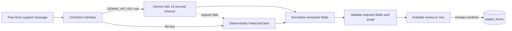

# Form Fill AI

Form Fill AI turns an unstructured support message into a reviewable Harbor Desk intake form. It extracts the customer, email, product, urgency, and issue summary; validates required fields and email format; and only saves after a person confirms the draft.

The seeded demo messages and all displayed customer details are fictional. No customer data, payment processing, or external CRM is used.

## How the AI flow works



The provider boundary is `App\Services\Llm\LlmClient`. `FormFiller` normalizes provider output and validates it independently of the model. Gemini errors and timeouts fall back to the local `FakeLlmClient`, so the demo remains usable without an API key or a working model connection. Missing values stay blank rather than being invented. The browser lets an operator edit the draft; the save endpoint validates it again before persistence.

## Run locally (no API key required)

Requirements: PHP 8.3+, Composer, Node.js 22+, and npm.

```bash
composer setup
php artisan db:seed
composer dev
```

Open the local URL printed by `php artisan serve` (usually `http://127.0.0.1:8000`). The seeded workspace offers four fictional sample messages, including one without an email to demonstrate validation.

The default configuration uses SQLite and the deterministic local extractor. `GEMINI_API_KEY` is optional. To enable Gemini, set it in `.env`; `GEMINI_MODEL` defaults to `gemini-2.5-flash`. Gemini requests are capped at 12 seconds and fall back locally if the provider fails.

To run the app with separate commands instead of `composer dev`:

```bash
php artisan serve
npm run dev
```

## Tests and AI behavior

Run the test suite and static checks with:

```bash
composer test
```

Pest feature tests use the fake LLM and verify that a complete message fills customer, email, and product; a missing email is reported invalid; the no-key service binding selects `FakeLlmClient`; unauthenticated preview requests return HTTP 200; and a confirmed, valid form is persisted. A failure-path test also verifies local extraction is used when a configured provider throws.

Frontend checks and build:

```bash
npm run check
npm run types:check
npm run build
```

## Stack

- Laravel 13 / PHP 8.3+
- Vue 3, Inertia, and Tailwind CSS
- Pest for behavior tests
- SQLite for local persistence
